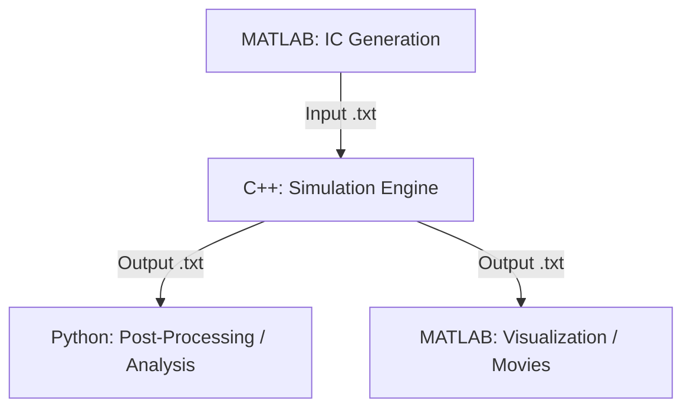

# Vertex Model — File Structure

> **Maintainability note:** When you add or remove files/directories, update this file immediately to keep it accurate.

---

## Repository Root

```
Lubensky-Lab-Vertex-Models/
├── CLAUDE.md                          # Claude Code instructions and project guidance
├── GEMINI.md                          # [DOCUMENTATION] Gemini CLI instructions and role definition
├── README.md                          # General project README
├── vm_file_structure.md               # This file — canonical directory map
├── [CPP Code Base/](CPP%20Code%20Base/)                 # [FOUNDATION] Base C++ class library
├── CPP Code Base.zip                  # Archive of base code
├── [AG Vertex Model/](AG%20Vertex%20Model/)               # [SIMULATION] AG variant — main simulation code
├── [MATLAB Code Folder/](MATLAB%20Code%20Folder/)            # [IC GENERATION / VISUALIZATION]
├── [Python Code Folder/](Python%20Code%20Folder/)            # [POST-PROCESSING / ANALYSIS]
├── [Cluster Files/](Cluster%20Files/)                  # [DEPLOYMENT] SLURM scripts for Great Lakes HPC
├── [Vertex Model Documentation/](Vertex%20Model%20Documentation/)    # [DOCUMENTATION] LaTeX/PDF docs and slides
├── [Vertex Model Tutorial v2.0 2020/](Vertex%20Model%20Tutorial%20v2.0%202020/) # [DOCUMENTATION] Tutorials and examples
├── [vm_claude_actions/](vm_claude_actions/)               # [AGENT STATE] Claude task tracking
├── [vm_claude_plans/](vm_claude_plans/)                 # [AGENT STATE] Dated, approved Claude implementation plans awaiting/undergoing execution
├── [vm_claude_reports/](vm_claude_reports/)             # Detailed reports of all vertex-model code changes, for publication (2026-10-15 onward)
├── vm_claude_proposed_fixes.md         # [AGENT STATE] Claude's audit of shear-modulus/Hessian code vs. the derivations doc
├── [vm_gemini_actions/](vm_gemini_actions/)               # [AGENT STATE] Gemini task tracking, lessons, and logs
├── [vm_human_calculations/](vm_human_calculations/)             # [DOCUMENTATION] Hand-derived notes, LaTeX writeups, and Mathematica notebooks
└── [vm_llm_research/](vm_llm_research/)                 # [RESEARCH] Gemini-powered project research and planning
```

---

## [vm_llm_research/](vm_llm_research/)

Central repository for deep-dive research, scientific brainstorming, and architectural planning conducted with LLMs.

- `Gemini-*.txt`: Detailed research notes and prompt-engineering results for specific features (e.g., Shear Modulus calculations).

---

## [CPP Code Base/](CPP%20Code%20Base/)

Base C++ classes shared across all simulation variants. This is the foundation layer.

```
CPP Code Base/
├── VectClass.cpp / .h        # 2D vector math (Vect class)
├── VertexClass.cpp / .h      # Vertex: position, connectivity
├── EdgeClass.cpp / .h        # Edge: connects two vertices
├── CellClass.cpp / .h        # Cell: polygon defined by edges/vertices
├── TissueClass.cpp / .h      # Tissue: collection of cells, RK4 integrator
├── Constants.h               # Global simulation constants
├── MainBase.cpp              # Entry point for base model
└── VertexModelBase/          # Visual Studio solution for base model
```

---

## [AG Vertex Model/](AG%20Vertex%20Model/)

AG (Anisotropic Growth) vertex model — NPT-ensemble simulation with box evolution.
**Dependency:** This variant requires and includes subclasses from `CPP Code Base/`.

```
AG Vertex Model/
└── AGVertexModel/
    ├── AGVertexModel.sln              # Master VS solution
    ├── AGVertexModel/                 # Core AG class library
    ├── AGPerimVertex/                 # Perimeter vertex model (AG variant)
    │   └── MainAGPerim_claude.cpp     # batch copy of MainAGPerim.cpp: argv in + output folder, writes _EQ.txt only if equilibrated (2026-10-15)
    ├── AGPerimModuli/                 # ** BRANCH SCOPE ** Elastic moduli calculation
    ├── AGStiffness/                   # ** BRANCH SCOPE ** Shear/elastic stiffness
    ├── AGStiffEquilibrate/            # Equilibrate tissue before stiffness calc
    ├── AGPerimHessian_test/           # ** BRANCH SCOPE ** Hessian matrix extraction
    │   └── AGPerimHessian_test/MainHess_claude.cpp  # batch copy of MainHessianTest.cpp: argv in, no evolve, writes <tissue>_SM.txt (2026-10-15)
    ├── AGPerimAffine_test/            # Affine response testing
    ├── AGProliferate/                 # Proliferating tissue simulation
    ├── AGCompressFluidize/            # Compression-driven fluidization
    └── packages/                      # NuGet packages (Eigen 3.3.9)
```

---

## [MATLAB Code Folder/](MATLAB%20Code%20Folder/)

Scripts for generating Voronoi-based initial tissue configurations and analyzing output.

- `GenerationVoronoi_*.m`: [IC GENERATION] Scripts for creating initial packings.
- `CreateMovie.m`: [VISUALIZATION] Main script for rendering simulation results.
- `CreateMovie_HelpperFunctions/`: Support scripts for data parsing and plotting.

---

## [Python Code Folder/](Python%20Code%20Folder/)

Post-processing and analysis scripts.

- `script_TO_CALC_SM_FROM_CPP.py`: [ANALYSIS] **BRANCH SCOPE** Shear modulus processing.
- `shapely_VM_analyzer.py`: [ANALYSIS] Geometry analysis using Shapely.
- `bristle-data-mondal-2025.yml`: Conda environment definition.

---

## [vm_claude_plans/](vm_claude_plans/)

User-approved implementation plans awaiting or undergoing execution, written when a task is non-trivial enough to require plan mode (per `CLAUDE.md`). Each file is dated and named descriptively.

- `YYYY-MM-DD_<descriptive-slug>.md`: one plan per file, with a `**Status:**` line at the top tracking whether it's approved-but-not-started, in progress, or done.

---

## [vm_gemini_actions/](vm_gemini_actions/)

Gemini CLI task and lesson tracking.

- `vm_gemini_todo.md`: Current task plan for Gemini.
- `vm_gemini_recentactions.md`: Log of session actions and historical summaries.
- `vm_gemini_lessons.md`: Accumulated lessons and feedback for agent refinement.

---

## Scientific Workflow


